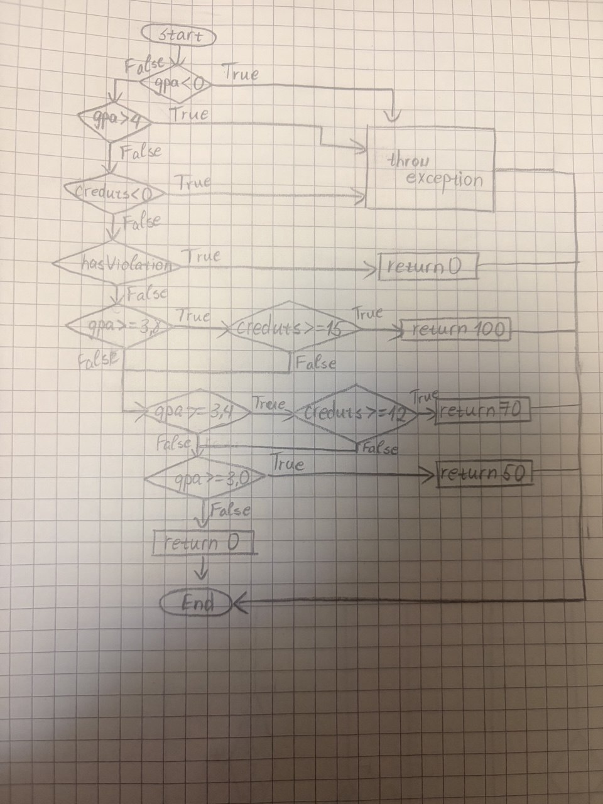

B232270024 О.Дэлгэрмаа

## Орчин
java:
delgermaa@debian:~/lab09$ java -version
openjdk version "17.0.19" 2026-04-21
OpenJDK Runtime Environment (build 17.0.19+10-1-deb12u2-Debian)
OpenJDK 64-Bit Server VM (build 17.0.19+10-1-deb12u2-Debian, mixed mode, sharing)

mv:
delgermaa@debian:~/lab09$ mvn -version
Apache Maven 3.9.9
Maven home: /usr/share/maven
Java version: 17.0.19, vendor: Debian, runtime: /usr/lib/jvm/java-17-openjdk-amd64
Default locale: en_US, platform encoding: UTF-8
OS name: "linux", version: "6.12.111+deb13-amd64", arch: "amd64", family: "unix"

## Хэсэг A: Happy path тестүүд ба эхний хэмжилт

ScholarshipCalculatorTest-д зөвхөн хэвийн урсгалын тестүүдийг бичсэн. Үр дүн (`results/jacoco-A.csv`):

| Хэмжүүр | Хүрээгүй | Хамрагдсан | Хамралт |
|---|---|---|---|
| Instruction | 57 | 95 | 62.5% |
| Branch | 23 | 18 | 43.9% (18/41) |
| Line | 11 | 14 | 56.0% (14/25) |
| Method | 0 | 4 | 100% |

**Ажиглалт.** Хамгийн муу хамрагдсан функц нь `scholarship` Branch 38%, дараа нь `letterGrade` 41%, `gpa` 54% байна. Улаан (огт хүрээгүй) мөрүүд нь голдуу `IllegalArgumentException` шидэх алдааны замууд бөгөөд happy path тест тэдгээрийг огт дайрдаггүй ба шар ромботой салаанууд нь нөхцөл нэг талаараа л шалгагдсан `if`-үүд байна.

## Хэсэг B: CFG зурж branch 100% хүрэх

`scholarship()` функцын CFG-г гараар зурж (`cfg.jpg`), нөхцөл бүрийн True/False
ирмэгт тестийн нэрийг буулгасан: гурван нөхцөлийн exception
(`negativeGpaThrows`, `gpaAboveFourThrows`, `negativeCreditsThrows`),
`violationReturnsZero`, `gpa38Credits15Gives100`, `gpa38LowCreditsFallsTo70`,
`gpa34Credits12Gives70`, `gpa34LowCreditsFallsTo50`, `gpa30Gives50`,
`lowGpaGivesZero`.

Branch ба Line хамралтыг 100% хүргэхэд нийт **25 тест** шаардагдсан
(`results/mvn-verify-B.txt`: `Tests run: 25, Failures: 0`).
`results/jacoco-B.csv`: BRANCH_MISSED = 0 (41/41), LINE_MISSED = 0 (25/25).

Анх A хэсгийн 5 тестээр Branch 18/41 байсан. Дутуу байсан салаанууд нь
`letterGrade()`-ийн C/D/F болон 0-100-аас гадуурх оноо, `scholarship()`-ийн
нөхцөл бүрийн exception ба кредит дутуу тохиолдлууд, `gpa()`-ийн `null`/хоосон
массив, `switch`-ийн C, D, default (F) тохиолдлууд байв.