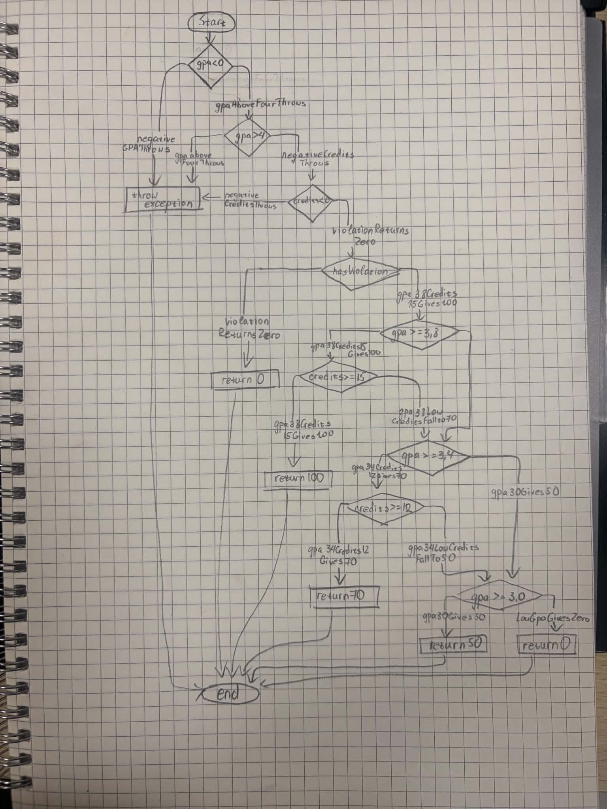

# Лаборатори 9: Код хамралт — JaCoCo

B232270024 О.Дэлгэрмаа

## Орчин

```
delgermaa@debian:~/lab09$ java -version
openjdk version "17.0.19" 2026-04-21
OpenJDK Runtime Environment (build 17.0.19+10-1-deb12u2-Debian)
OpenJDK 64-Bit Server VM (build 17.0.19+10-1-deb12u2-Debian, mixed mode, sharing)

delgermaa@debian:~/lab09$ mvn -version
Apache Maven 3.9.9
Maven home: /usr/share/maven
Java version: 17.0.19, vendor: Debian, runtime: /usr/lib/jvm/java-17-openjdk-amd64
Default locale: en_US, platform encoding: UTF-8
OS name: "linux", version: "6.12.111+deb13-amd64", arch: "amd64", family: "unix"
```

## Хэсэг A: Happy path тестүүд ба эхний хэмжилт

`ScholarshipCalculatorTest`-д зөвхөн хэвийн урсгалын 5 тест бичсэн. Үр дүн (`results/jacoco-A.csv`):

| Хэмжүүр | Хүрээгүй | Хамрагдсан | Хамралт |
|---|---|---|---|
| Instruction | 57 | 95 | 62.5% |
| Branch | 23 | 18 | 43.9% (18/41) |
| Line | 11 | 14 | 56.0% (14/25) |
| Method | 0 | 4 | 100% |

**Ажиглалт.** Функц тус бүрийн хувийг HTML тайлангаас (`results/jacoco-A-report.png`) уншсан, учир нь `jacoco-A.csv` зөвхөн класс бүрийн нэг мөр агуулдаг. Хамгийн муу нь `scholarship` (Branch 38%), дараа нь `letterGrade` (41%), `gpa` (54%). Улаан мөрүүд нь голдуу `IllegalArgumentException` шидэх замууд бөгөөд happy path тест тэдгээрт хүрдэггүй. Шар ромботой мөрүүд нь `if` нөхцөл зөвхөн нэг талаараа (жишээ нь үргэлж true) шалгагдсан газрууд байна.

## Хэсэг B: CFG зурж Branch 100% хүрэх

`scholarship()` функцын CFG-г гараар зурсан: 

Нөхцөл бүр тусдаа зангилаа (N1–N9), үр дүн бүр тусдаа зангилаа (N10–N15) болсон. Ирмэг бүр дээр True/False ба түүнийг дайрдаг тестийн нэрийг бичсэн:

| Ирмэг | Тест |
|---|---|
| N1 (`gpa < 0`) T → N10 | `negativeGpaThrows` |
| N2 (`gpa > 4`) T → N10 | `gpaAboveFourThrows` |
| N3 (`credits < 0`) T → N10 | `negativeCreditsThrows` |
| N4 (`hasViolation`) T → N11 | `violationReturnsZero` |
| N5 T → N6, N6 T → N12 (100) | `gpa38Credits15Gives100` |
| N6 F → N7 (голч хангасан, кредит дутуу) | `gpa38LowCreditsFallsTo70` |
| N7 T → N8, N8 T → N13 (70) | `gpa34Credits12Gives70` |
| N8 F → N9 (голч хангасан, кредит дутуу) | `gpa34LowCreditsFallsTo50` |
| N9 T → N14 (50) | `gpa30Gives50` |
| N9 F → N15 (0) | `lowGpaGivesZero` |

Branch ба Line хамралтыг 100% хүргэхэд нийт **25 тест** шаардагдсан (`results/mvn-verify-B.txt`: `Tests run: 25, Failures: 0`). `results/jacoco-B.csv`: BRANCH_MISSED = 0 (41/41), LINE_MISSED = 0 (25/25).

A хэсгийн 5 тестээр дутуу байсан зүйлс: `letterGrade()`-ийн C/D/F ба 0–100-аас гадуурх оноо, `scholarship()`-ийн гурван нөхцөл бүрийн exception болон кредит дутуу тохиолдлууд, `gpa()`-ийн `null` ба хоосон массив, `switch`-ийн C, D, default (F) салаанууд.

## Хэсэг C: Давталтын заагийн тестүүд

`gpa()` доторх давталтад 0 / 1 / 2+ дүрмийг хэрэгжүүлсэн:

- 0 удаа: `gpaLoopZero_nullThrows`, `gpaLoopZero_emptyThrows` (`assertThrows`)
- 1 удаа: `gpaLoopOne_singleScoreIsFour` — `gpa([95]) == 4.0`
- 2+ удаа: `gpaLoopMany_fourScores` — `gpa([95, 85, 75, 65]) == 2.5`

Эдгээр тест хамралтын тоог өсгөөгүй, учир нь Хэсэг B-ийн дараа хамралт аль хэдийн 100% байсан. Гэхдээ хамралт нь мөр ажилласныг л харуулдаг, харин давталт нэг дүнтэй болон олон дүнтэй үед нийлбэр, хуваагч зөв гарч байгааг эдгээр тест л шалгана.

## Хэсэг D: Хамралт 100% — гэхдээ алдаа амьд

Спецификаци 60–69.99 оноог "D" гэсэн тул зааг утгын 7 тест нэмсэн. `results/mvn-test-D-fail.txt`:

```
boundary_60_isD ... expected: <D> but was: <F>
Tests run: 36, Failures: 1
```

Шалтгаан: `letterGrade()`-д `score > 60` гэж бичсэн, харин спецификацаар `score >= 60` байх ёстой. Засварыг тусдаа commit-оор хийсэн: `Fix letterGrade: > 60 -> >= 60, spec says 60 is D`. Засварын дараа `results/mvn-verify-final.txt`: `Tests run: 36, Failures: 0`, `results/jacoco-final.csv`: BRANCH_MISSED = 0 (41/41), LINE_MISSED = 0 (25/25).

**Дүгнэлт.** Хэсэг B-д Branch 100% байсан ч энэ алдаа илрээгүй. `score > 60` болон `score >= 60` хоёр нь адилхан "үнэн" ба "худал" гэсэн хоёр салаа үүсгэдэг. Миний тестүүд 65 (үнэн) ба 30 (худал) гэсэн утгаар хоёр салааг аль хэдийн дайрсан тул JaCoCo 100% гэж тооцсон. Харин яг 60 гэсэн утга л хоёр нөхцөлийг ялгадаг. JaCoCo нь код ажилласан эсэхийг хэмждэг ч хариу зөв эсэхийг хэмждэггүй. Тиймээс 100% хамралт нь тестийн чанарын хангалттай нотолгоо биш, зөвхөн хэмжүүр юм.

## Нэмэлт даалгавар: Coverage gate ба CI

`pom.xml`-д `jacoco:check` дүрэм нэмж, Branch хамралт 90%-иас доош бол `mvn verify` унадаг болгосон. `.github/workflows/ci.yml` нь push бүрт `mvn -B verify` ажиллуулж, JaCoCo тайланг artifact болгон хадгална. Gate нь тест огт хөндөөгүй кодыг барьдаг ч `score > 60` шиг алдааг барьж чадахгүй, учир нь тэр үед ч хамралт 100% байсан.

## AI ашигласан эсэх

Энэ лабт Claude (Anthropic)-ийг дараах зүйлд ашигласан:
- Лабын заавар болон Хэсэг A–D-ийн алхмуудыг ойлгоход, `mvn`/`git` командын дарааллыг лавлахад.
- Хэсэг D-ийн зааг утгын тестүүдийн жагсаалт болон `score > 60` алдааг спецификацитай тулгахад.
- `scholarship()`-ийн CFG-ийн бүтэц (зангилаа, ирмэг тус бүрийн тест) шалгахад, лавлах Mermaid диаграм (`cfg.mmd`) үүсгэхэд. Эцсийн `cfg.png`-ийг би цаасан дээр гараар зурсан.
- Coverage gate-ийн `pom.xml` хэсэг болон `ci.yml`-ийн загварт.

Тестүүдийг ажиллуулж, хамралтын тоо, унасан тестийн гаралтыг өөрийн машин дээр гаргасан.